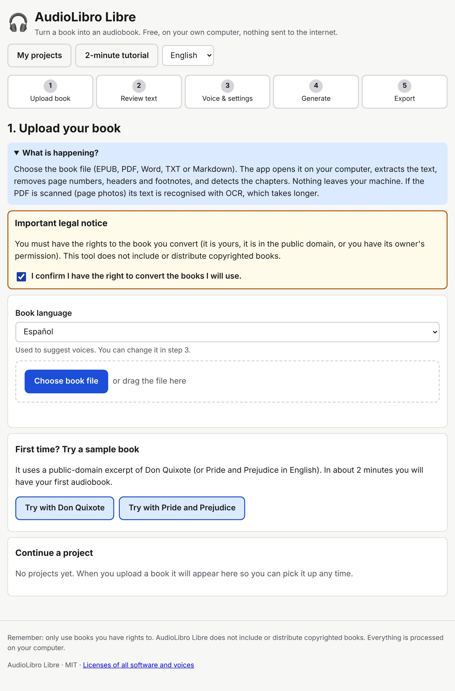
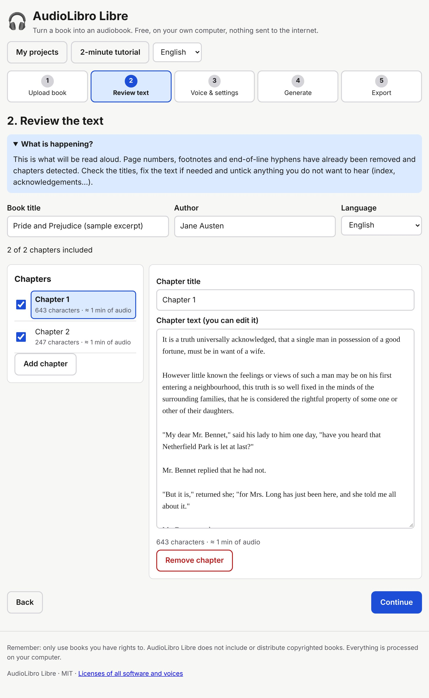
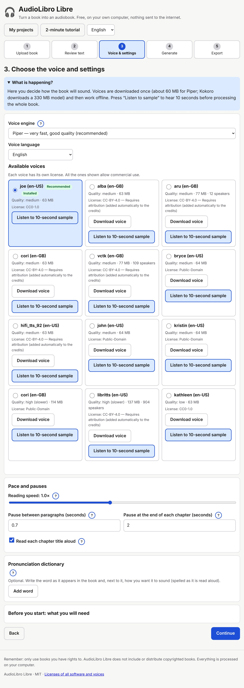
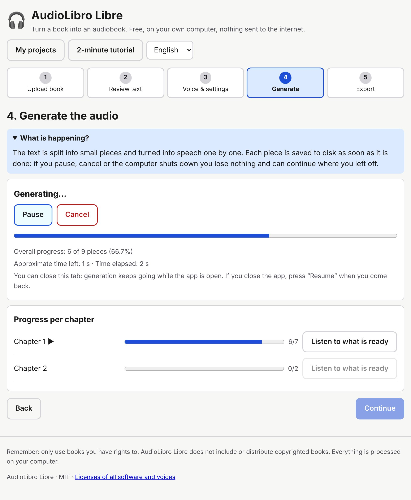
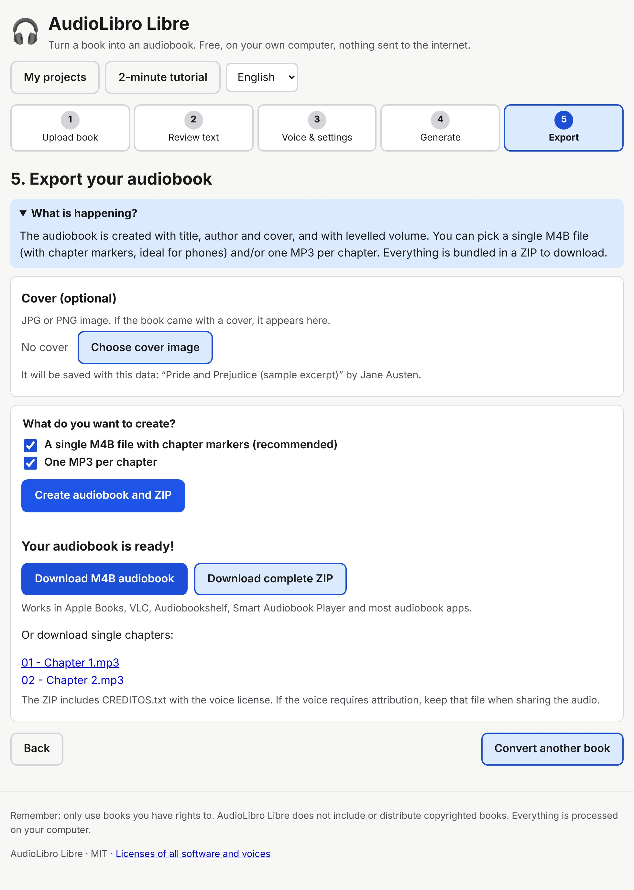
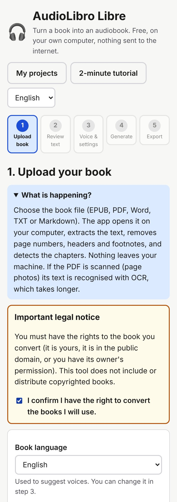
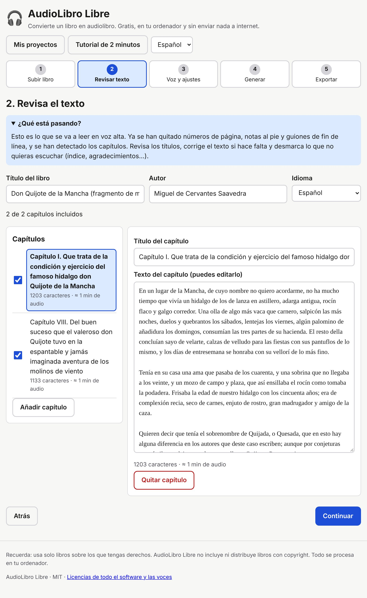
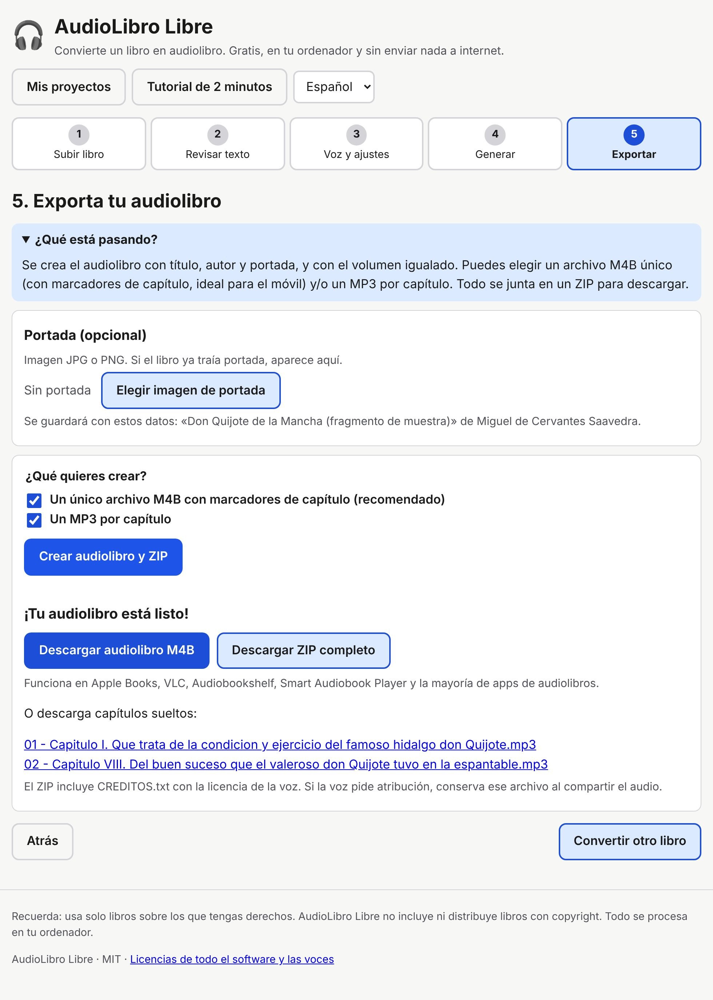
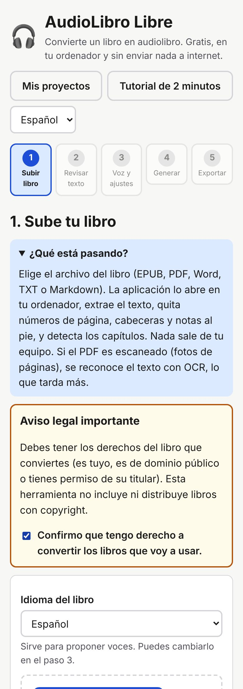

# AudioLibro Libre

**[English](#english) · [Español](#español)**

---

<a name="english"></a>
## English

**Convert a book into an audiobook with chapters. Free, runs entirely on the user's computer, requires no accounts or API keys, and never sends the book to any server.**

AudioLibro Libre takes a book (EPUB, PDF, Word, TXT or Markdown), lets the user choose a voice and produces an audiobook: a single **M4B** file with chapter markers and/or one **MP3 per chapter**, including title, author and cover art. Each screen of the five-step wizard explains what is happening and why.

> **Legal notice.** Users must hold the rights to any book they convert (their own work, public domain, or with the rights holder's permission). This software does not include or distribute copyrighted books. The sample books are public-domain excerpts (Cervantes and Austen).

### Key features
- Five-step wizard: upload, review text, choose voice and settings, generate, export.
- Input formats: EPUB, PDF (text-based or scanned, with optional OCR), DOCX, TXT and Markdown.
- Automatic chapter detection; removal of page numbers, repeated headers and footers, footnotes and end-of-line hyphenation; editable text and chapter selection.
- Two voice engines: **Piper** (fast, default) and **Kokoro** (more natural, slower), with a 10-second preview and an editable pronunciation dictionary.
- Pause, cancel and resume without losing progress: every audio fragment is saved to disk as soon as it is generated.
- Output: M4B with chapter markers, MP3 per chapter with ID3 tags and cover art, loudness normalization, and a ZIP download.
- Interface in English and Spanish; accessible (keyboard navigation, labels, contrast).
- Runs on CPU. Works offline once the voice model has been downloaded.

### Requirements
- A computer running Windows, macOS or Linux with **8 GB of RAM** and **5 GB of free disk space**. A graphics card is not required.
- Internet access is needed only for installation and to download a voice model the first time (about 60 MB). Afterwards the application works **offline**.
- All software and voice models are free and licensed for commercial use (see [`LICENSES.md`](LICENSES.md)).

### Installation

Choose one of the following options.

#### Option A: Docker (recommended)

1. Install **Docker Desktop** from <https://www.docker.com/products/docker-desktop/> and start it. On Linux, Docker Engine with the `docker compose` plugin is sufficient.
   *Docker Desktop is free for personal, educational and small-business use; larger organizations require a paid license. If that applies, use Option B, which relies only on free software.*
2. Download this repository (**Code > Download ZIP**, or the ZIP attached to the latest release) and extract it.
3. Open a terminal in the extracted folder. This is the only step that requires a terminal.
   - *Windows:* open the folder in File Explorer, click the address bar, type `cmd` and press Enter.
   - *macOS:* open Terminal, type `cd ` (with a trailing space), drag the folder into the window and press Enter.
   - *Linux:* right-click the folder and choose "Open in Terminal".
4. Run the following command. The first run builds the image and takes several minutes.

   ```bash
   docker compose up -d
   ```
5. Open <http://localhost:8000> in a web browser.

On later occasions, the application is available at the same address whenever Docker is running. To stop it, use the stop button next to `audiolibro-libre` in Docker Desktop, or run `docker compose down`.

#### Option B: Installer scripts (without Docker)

- **Windows:** double-click `install.bat`. The script verifies that Python, ffmpeg and espeak-ng are available, explains how to install anything that is missing, and then opens the browser.
- **macOS / Linux:** run `./install.sh` in a terminal opened in the project folder. The script verifies Python, ffmpeg and espeak-ng (and offers to install them), creates a virtual environment and opens the browser.

Subsequent launches use the same script and start within seconds.

#### Option C: Google Colab (optional)

For computers that are too slow to run the application locally, [`notebooks/AudioLibroLibre_Colab.ipynb`](notebooks/AudioLibroLibre_Colab.ipynb) runs it on Google Colab. **Review its limitations first:** the book is uploaded to a Google server (processing is not local), free sessions disconnect and erase their contents, and a speed improvement is not guaranteed. The notebook is untested.

#### Option D: macOS application (Apple Silicon), in preparation

A native `AudioLibro Libre.app`, distributed as a `.dmg`, that does not require Python or any other installation. Because the application is not signed with a paid developer certificate, macOS asks for confirmation on first launch (System Settings > Privacy & Security > "Open Anyway"). Build instructions and the list of items still to be verified are in [`docs/MAC_APP.md`](docs/MAC_APP.md).

### Quick start: your first audiobook in five steps

On the first screen, select **"2-minute tutorial"** (or **"Try with Pride and Prejudice"**) to be guided through the process with a public-domain sample book. Every screen includes a **"What is happening?"** panel and contextual help (**?**) for each setting.

**1. Upload the book.** Accept the legal notice and select a file (or drag it onto the page). Scanned PDFs are processed with OCR, which requires Tesseract (included with Docker).



**2. Review the text.** Page numbers, footnotes and headers have been removed and chapters detected. Edit titles or text and clear the checkbox of any section that should not be narrated (index, acknowledgements, and so on).



**3. Choose the voice and settings.** Select the engine and voice, listen to a **10-second sample**, adjust speed and pauses, and optionally add entries to the **pronunciation dictionary** (names, acronyms). The page shows the estimated time, disk space and memory required, measured on the user's machine.



**4. Generate.** Progress is shown per chapter with the estimated remaining time, and the audio generated so far can be previewed. Generation can be **paused, cancelled and resumed** without loss of work, even after the computer has been shut down.



**5. Export.** Choose **M4B** (a single file with chapter markers, suited to mobile devices) and/or **one MP3 per chapter**, optionally add a cover image, and download the result as a **ZIP** archive.



The interface adapts to mobile and tablet screens and supports keyboard navigation:



### Performance and resource usage

Measured with a book of approximately 290 pages (81,000 words, 30 chapters, about 8 hours of audio) on a 4-core CPU, without internet access:

| | **Piper** (default) | **Kokoro** (optional) |
|---|---|---|
| Generation time | about **20 minutes** | about 2.4 hours |
| Characteristics | fast, good quality | more natural, slower |
| Voice model download | 63 MB | 326 MB (shared by all voices) |
| Peak memory | about 0.6 GB | about 1.1 GB |

- Exporting M4B, MP3 and ZIP for that book takes about 13 minutes; the M4B is approximately 245 MB.
- Disk usage is about 1.6 GB per eight-hour book, peaking at about 2.7 GB during export.
- Older hardware may be two to five times slower. Before generation starts, the application shows an estimate measured on the user's own machine.

### Supported formats and known limitations

EPUB, PDF (text-based or scanned), DOCX, TXT and Markdown. Known limitations:
- Multi-column PDFs are not handled correctly.
- A subtitle below a chapter title may be merged with the first paragraph; it can be corrected in step 2.
- EPUB files protected by DRM cannot be read.
- OCR accuracy decreases on poor-quality scans.

### Troubleshooting

| Symptom | Resolution |
|---|---|
| <http://localhost:8000> does not open | With Docker, confirm in Docker Desktop that the `audiolibro-libre` container is running. If port 8000 is in use, change `"127.0.0.1:8000:8000"` to `"127.0.0.1:8080:8000"` in `docker-compose.yml` and open <http://localhost:8080>. |
| Docker does not start, or reports a virtualization error (Windows) | Enable virtualization in the BIOS/UEFI and install WSL 2 (Docker Desktop provides guidance). Otherwise use Option B. |
| "ffmpeg is missing" or "espeak-ng is missing" | Not applicable with Docker. Otherwise: Windows, `winget install Gyan.FFmpeg` and the espeak-ng installer from its [releases page](https://github.com/espeak-ng/espeak-ng/releases); macOS, `brew install ffmpeg espeak-ng`; Linux, `sudo apt install ffmpeg espeak-ng`. Restart the application afterwards. |
| The voice cannot be downloaded | Internet access is required only for this step. Check the connection; behind a corporate proxy or firewall, allow `huggingface.co`. |
| Scanned PDF: "Tesseract is missing" | Included with Docker. Otherwise: Windows, the [Tesseract installer](https://github.com/UB-Mannheim/tesseract/wiki) with the required language; macOS, `brew install tesseract tesseract-lang`; Linux, `sudo apt install tesseract-ocr tesseract-ocr-spa`. |
| A word or name is mispronounced | Add an entry to the pronunciation dictionary in step 3 (for example, "guai fai" for "WiFi"). |
| Generation is slow | Use Piper instead of Kokoro, close other applications and review the estimate in step 3. |
| Insufficient disk space | Check the estimate in step 3 and delete old projects under "My projects". Note that `docker compose down -v` deletes all application data. |
| The application was closed during generation | No work is lost. Open the project under "My projects" and select **Resume**. |
| A player does not support M4B | Use the per-chapter MP3 files, which are supported universally. |

Further solutions and instructions for viewing logs: [`docs/TROUBLESHOOTING.md`](docs/TROUBLESHOOTING.md).

### Privacy and offline operation

The book never leaves the user's computer. The only network access is the one-time download of voice models from Hugging Face. Once a voice is installed, the application works without a connection.

### Test status

| Area | Status |
|---|---|
| Linux: clean installation with `install.sh` (Python 3.11) and the complete automated test suite on Python 3.11 and 3.13 | Verified |
| Approximately 290-page book processed offline, with a forced process termination followed by resumption | Verified (synthetic text) |
| Docker image | Written and validated statically (`docker compose config`, simulated build steps); **not built**, because the development environment has no Docker engine |
| Windows (`install.bat`) and macOS (`install.sh`) | Written, **not executed** on those systems |
| macOS application (`.app` / `.dmg`) | Launcher, self-test and packaging verified on Linux; **building and running on macOS has not been tested** (see [`docs/MAC_APP.md`](docs/MAC_APP.md)) |
| Google Colab notebook | **Not tested** |
| Audio quality | Verified with automatic speech recognition; **evaluation by human listeners is pending** |

Issue reports from other platforms are welcome.

### Development

```bash
python -m venv .venv && . .venv/bin/activate
pip install -e ".[dev]"
./check.sh          # ruff + pytest, run locally (the project has no CI)
```

Documentation: [`CONTRIBUTING.md`](CONTRIBUTING.md) · [`docs/ARCHITECTURE.md`](docs/ARCHITECTURE.md) · [`docs/ADDING_A_VOICE_ENGINE.md`](docs/ADDING_A_VOICE_ENGINE.md) · [`docs/RELEASING.md`](docs/RELEASING.md) · [`docs/DECISIONS.md`](docs/DECISIONS.md) (license research and measurements) · [`LICENSES.md`](LICENSES.md) · [`CHANGELOG.md`](CHANGELOG.md)

### License

MIT. Voices and dependencies carry their own permissive licenses, documented in [`LICENSES.md`](LICENSES.md). One documented exception applies: **espeak-ng** (GPL-3.0) is executed as a separate external program and is never linked.

---

<a name="español"></a>
## Español

**Convierte un libro en un audiolibro con capítulos. Es gratuito, se ejecuta íntegramente en el ordenador del usuario, no requiere cuentas ni claves de API y nunca envía el libro a ningún servidor.**

AudioLibro Libre toma un libro (EPUB, PDF, Word, TXT o Markdown), permite al usuario elegir una voz y genera un audiolibro: un único archivo **M4B** con marcadores de capítulo y/o un **MP3 por capítulo**, con título, autor y portada. Cada pantalla del asistente de cinco pasos explica qué está ocurriendo y por qué.

> **Aviso legal.** El usuario debe tener los derechos de cualquier libro que convierta (obra propia, dominio público o permiso del titular de los derechos). Este software no incluye ni distribuye libros con copyright. Los libros de ejemplo son fragmentos de dominio público (Cervantes y Austen).

### Características principales
- Asistente de cinco pasos: subir, revisar el texto, elegir voz y ajustes, generar y exportar.
- Formatos de entrada: EPUB, PDF (con texto o escaneado, con OCR opcional), DOCX, TXT y Markdown.
- Detección automática de capítulos; eliminación de números de página, cabeceras y pies repetidos, notas al pie y guiones de fin de línea; texto editable y selección de capítulos.
- Dos motores de voz: **Piper** (rápido, por defecto) y **Kokoro** (más natural, más lento), con muestra de 10 segundos y diccionario de pronunciación editable.
- Pausar, cancelar y reanudar sin perder el progreso: cada fragmento de audio se guarda en disco en cuanto se genera.
- Salida: M4B con marcadores de capítulo, MP3 por capítulo con etiquetas ID3 y portada, normalización de volumen y descarga en ZIP.
- Interfaz en español e inglés; accesible (navegación por teclado, etiquetas, contraste).
- Funciona en CPU. Opera sin conexión una vez descargado el modelo de voz.

### Requisitos
- Un ordenador con Windows, macOS o Linux, con **8 GB de memoria RAM** y **5 GB de espacio libre en disco**. No se necesita tarjeta gráfica.
- Solo se requiere conexión a internet para la instalación y para descargar un modelo de voz la primera vez (unos 60 MB). Después la aplicación funciona **sin conexión**.
- Todo el software y los modelos de voz son gratuitos y con licencias que permiten el uso comercial (véase [`LICENSES.md`](LICENSES.md)).

### Instalación

Elija una de las siguientes opciones.

#### Opción A: Docker (recomendada)

1. Instale **Docker Desktop** desde <https://www.docker.com/products/docker-desktop/> e inícielo. En Linux basta con Docker Engine y el complemento `docker compose`.
   *Docker Desktop es gratuito para uso personal, educativo y de pequeñas empresas; las organizaciones grandes necesitan una licencia de pago. En ese caso, utilice la Opción B, que solo emplea software libre.*
2. Descargue este repositorio (**Code > Download ZIP**, o el ZIP adjunto a la última versión publicada) y descomprímalo.
3. Abra una terminal en la carpeta descomprimida. Es el único paso que requiere una terminal.
   - *Windows:* abra la carpeta en el Explorador de archivos, haga clic en la barra de direcciones, escriba `cmd` y pulse Intro.
   - *macOS:* abra Terminal, escriba `cd ` (con un espacio al final), arrastre la carpeta a la ventana y pulse Intro.
   - *Linux:* haga clic derecho en la carpeta y seleccione «Abrir en una terminal».
4. Ejecute el siguiente comando. La primera ejecución construye la imagen y tarda varios minutos.

   ```bash
   docker compose up -d
   ```
5. Abra <http://localhost:8000> en un navegador web.

En ocasiones posteriores, la aplicación está disponible en la misma dirección mientras Docker esté en ejecución. Para detenerla, utilice el botón de parada junto a `audiolibro-libre` en Docker Desktop, o ejecute `docker compose down`.

#### Opción B: Scripts de instalación (sin Docker)

- **Windows:** haga doble clic en `install.bat`. El script comprueba que Python, ffmpeg y espeak-ng estén disponibles, explica cómo instalar lo que falte y, a continuación, abre el navegador.
- **macOS / Linux:** ejecute `./install.sh` en una terminal abierta en la carpeta del proyecto. El script comprueba Python, ffmpeg y espeak-ng (y ofrece instalarlos), crea un entorno virtual y abre el navegador.

Los inicios posteriores utilizan el mismo script y tardan unos segundos.

#### Opción C: Google Colab (opcional)

Para ordenadores demasiado lentos para ejecutar la aplicación localmente, [`notebooks/AudioLibroLibre_Colab.ipynb`](notebooks/AudioLibroLibre_Colab.ipynb) la ejecuta en Google Colab. **Revise antes sus limitaciones:** el libro se sube a un servidor de Google (el procesamiento no es local), las sesiones gratuitas se desconectan y borran su contenido, y no se garantiza una mejora de velocidad. El cuaderno no ha sido probado.

#### Opción D: aplicación para macOS (Apple Silicon), en preparación

Una aplicación nativa `AudioLibro Libre.app`, distribuida como `.dmg`, que no requiere Python ni ninguna otra instalación. Dado que la aplicación no está firmada con un certificado de desarrollador de pago, macOS solicita confirmación en el primer inicio (Ajustes del Sistema > Privacidad y seguridad > «Abrir igualmente»). Las instrucciones de construcción y la lista de elementos pendientes de verificar están en [`docs/MAC_APP.md`](docs/MAC_APP.md).

### Inicio rápido: el primer audiolibro en cinco pasos

En la primera pantalla, seleccione **«Tutorial de 2 minutos»** (o **«Probar con Don Quijote»**) para recorrer el proceso con un libro de ejemplo de dominio público. Cada pantalla incluye un panel **«¿Qué está pasando?»** y ayuda contextual (**?**) para cada ajuste.

**1. Subir el libro.** Acepte el aviso legal y seleccione un archivo (o arrástrelo a la página). Los PDF escaneados se procesan con OCR, que requiere Tesseract (incluido con Docker).


**2. Revisar el texto.** Se han eliminado los números de página, las notas al pie y las cabeceras, y se han detectado los capítulos. Edite títulos o texto y desmarque cualquier sección que no deba narrarse (índice, agradecimientos, etc.).



**3. Elegir la voz y los ajustes.** Seleccione el motor y la voz, escuche una **muestra de 10 segundos**, ajuste la velocidad y las pausas y, opcionalmente, añada entradas al **diccionario de pronunciación** (nombres, siglas). La página muestra el tiempo, el espacio en disco y la memoria estimados, medidos en el equipo del usuario.


**4. Generar.** Se muestra el progreso por capítulo con el tiempo restante estimado, y se puede escuchar el audio generado hasta el momento. La generación puede **pausarse, cancelarse y reanudarse** sin pérdida de trabajo, incluso después de apagar el ordenador.


**5. Exportar.** Elija **M4B** (un único archivo con marcadores de capítulo, adecuado para dispositivos móviles) y/o **un MP3 por capítulo**, añada opcionalmente una portada y descargue el resultado en un archivo **ZIP**.



La interfaz se adapta a pantallas de móvil y tableta y admite la navegación por teclado:



### Rendimiento y uso de recursos

Medido con un libro de aproximadamente 290 páginas (81 000 palabras, 30 capítulos, unas 8 horas de audio) en una CPU de 4 núcleos, sin conexión a internet:

| | **Piper** (por defecto) | **Kokoro** (opcional) |
|---|---|---|
| Tiempo de generación | unos **20 minutos** | unas 2,4 horas |
| Características | rápido, buena calidad | más natural, más lento |
| Descarga del modelo de voz | 63 MB | 326 MB (compartido por todas las voces) |
| Memoria máxima | unos 0,6 GB | unos 1,1 GB |

- Exportar M4B, MP3 y ZIP de ese libro tarda unos 13 minutos; el M4B ocupa aproximadamente 245 MB.
- El uso de disco es de unos 1,6 GB por libro de ocho horas, con un máximo de unos 2,7 GB durante la exportación.
- Un equipo más antiguo puede ser entre dos y cinco veces más lento. Antes de iniciar la generación, la aplicación muestra una estimación medida en el propio equipo del usuario.

### Formatos admitidos y limitaciones conocidas

EPUB, PDF (con texto o escaneado), DOCX, TXT y Markdown. Limitaciones conocidas:
- Los PDF de varias columnas no se procesan correctamente.
- Un subtítulo situado bajo el título de un capítulo puede fusionarse con el primer párrafo; puede corregirse en el paso 2.
- Los EPUB protegidos con DRM no se pueden leer.
- La precisión del OCR disminuye con escaneos de baja calidad.

### Solución de problemas

| Síntoma | Solución |
|---|---|
| No se abre <http://localhost:8000> | Con Docker, confirme en Docker Desktop que el contenedor `audiolibro-libre` está en ejecución. Si el puerto 8000 está ocupado, cambie `"127.0.0.1:8000:8000"` por `"127.0.0.1:8080:8000"` en `docker-compose.yml` y abra <http://localhost:8080>. |
| Docker no se inicia o informa de un error de virtualización (Windows) | Active la virtualización en la BIOS/UEFI e instale WSL 2 (Docker Desktop ofrece asistencia). En caso contrario, utilice la Opción B. |
| «Falta ffmpeg» o «Falta espeak-ng» | No aplica con Docker. En otro caso: Windows, `winget install Gyan.FFmpeg` y el instalador de espeak-ng de su [página de versiones](https://github.com/espeak-ng/espeak-ng/releases); macOS, `brew install ffmpeg espeak-ng`; Linux, `sudo apt install ffmpeg espeak-ng`. Reinicie después la aplicación. |
| No se puede descargar la voz | Solo este paso requiere internet. Compruebe la conexión; detrás de un proxy o cortafuegos corporativo, permita `huggingface.co`. |
| PDF escaneado: «Falta Tesseract» | Incluido con Docker. En otro caso: Windows, el [instalador de Tesseract](https://github.com/UB-Mannheim/tesseract/wiki) con el idioma necesario; macOS, `brew install tesseract tesseract-lang`; Linux, `sudo apt install tesseract-ocr tesseract-ocr-spa`. |
| Una palabra o un nombre se pronuncia mal | Añada una entrada al diccionario de pronunciación en el paso 3 (por ejemplo, «guai fai» para «WiFi»). |
| La generación es lenta | Utilice Piper en lugar de Kokoro, cierre otras aplicaciones y revise la estimación del paso 3. |
| Espacio en disco insuficiente | Revise la estimación del paso 3 y elimine proyectos antiguos en «Mis proyectos». Tenga en cuenta que `docker compose down -v` borra todos los datos de la aplicación. |
| La aplicación se cerró durante la generación | No se pierde trabajo. Abra el proyecto en «Mis proyectos» y seleccione **Reanudar**. |
| Un reproductor no admite M4B | Utilice los MP3 por capítulo, compatibles universalmente. |

Más soluciones e instrucciones para consultar los registros: [`docs/TROUBLESHOOTING.md`](docs/TROUBLESHOOTING.md).

### Privacidad y funcionamiento sin conexión

El libro nunca sale del ordenador del usuario. El único acceso a la red es la descarga única de los modelos de voz desde Hugging Face. Una vez instalada una voz, la aplicación funciona sin conexión.

### Estado de las pruebas

| Área | Estado |
|---|---|
| Linux: instalación limpia con `install.sh` (Python 3.11) y suite automática completa con Python 3.11 y 3.13 | Verificado |
| Libro de unas 290 páginas procesado sin conexión, con terminación forzada del proceso y posterior reanudación | Verificado (texto sintético) |
| Imagen de Docker | Escrita y validada de forma estática (`docker compose config`, pasos de construcción simulados); **no construida**, porque el entorno de desarrollo no dispone de motor de Docker |
| Windows (`install.bat`) y macOS (`install.sh`) | Escritos, **no ejecutados** en esos sistemas |
| Aplicación para macOS (`.app` / `.dmg`) | Lanzador, autoprueba y empaquetado verificados en Linux; **la construcción y ejecución en macOS no se han probado** (véase [`docs/MAC_APP.md`](docs/MAC_APP.md)) |
| Cuaderno de Google Colab | **No probado** |
| Calidad del audio | Verificada con reconocimiento automático de voz; **está pendiente la evaluación por oyentes humanos** |

Se agradecen los informes de incidencias desde otras plataformas.

### Desarrollo

```bash
python -m venv .venv && . .venv/bin/activate
pip install -e ".[dev]"
./check.sh          # ruff + pytest, ejecutados en local (el proyecto no tiene CI)
```

Documentación: [`CONTRIBUTING.md`](CONTRIBUTING.md) · [`docs/ARCHITECTURE.md`](docs/ARCHITECTURE.md) · [`docs/ADDING_A_VOICE_ENGINE.md`](docs/ADDING_A_VOICE_ENGINE.md) · [`docs/RELEASING.md`](docs/RELEASING.md) · [`docs/DECISIONS.md`](docs/DECISIONS.md) (investigación de licencias y mediciones) · [`LICENSES.md`](LICENSES.md) · [`CHANGELOG.md`](CHANGELOG.md)

### Licencia

MIT. Las voces y las dependencias tienen sus propias licencias permisivas, documentadas en [`LICENSES.md`](LICENSES.md). Se aplica una excepción documentada: **espeak-ng** (GPL-3.0) se ejecuta como un programa externo independiente y nunca se enlaza.
