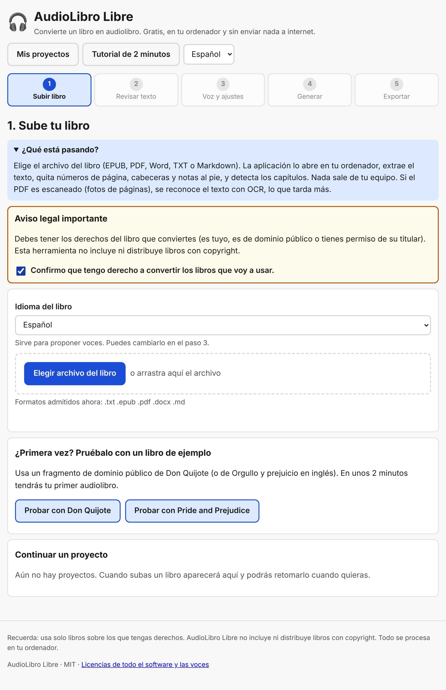
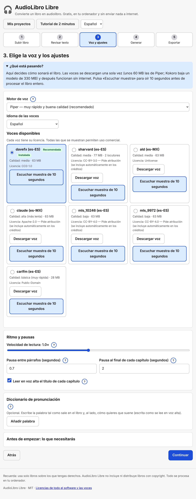
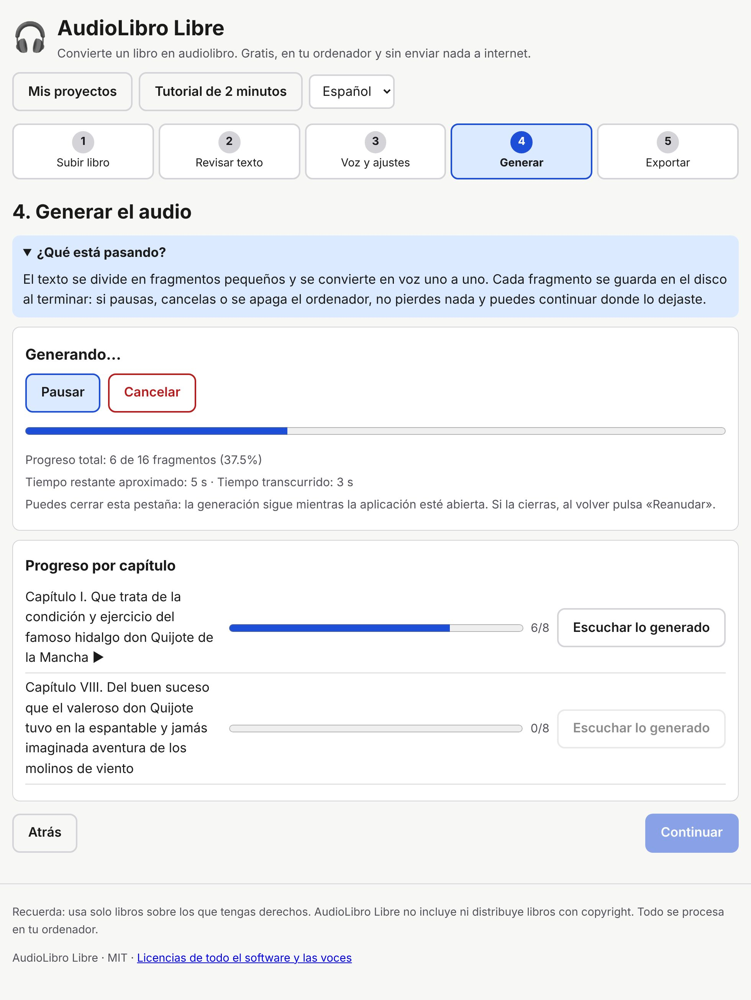

# 🎧 AudioLibro Libre

**[Español](#español) · [English](#english)**

---

<a name="español"></a>
## Español

**Convierte un libro en un audiolibro con capítulos. Gratis, en tu ordenador, sin cuentas, sin claves y sin enviar tu libro a ningún servidor.**

Das un libro (EPUB, PDF, Word, TXT o Markdown), eliges una voz y recibes un audiolibro: un **M4B** con marcadores de capítulo y/o un **MP3 por capítulo**, con título, autor y portada. Todo se explica en pantalla paso a paso.

> ⚠️ **Aviso legal.** Debes tener los derechos del libro que conviertes (es tuyo, es de dominio público o tienes permiso de su titular). Esta herramienta **no incluye ni distribuye libros con copyright**. Los libros de ejemplo son fragmentos de dominio público (Cervantes y Austen).

### ¿Qué necesito?
- Un ordenador con **8 GB de memoria** y **5 GB libres** de disco (Windows, Mac o Linux). No hace falta tarjeta gráfica.
- **Internet solo para instalar** y para descargar la voz la primera vez (unos 60 MB). Después funciona **sin internet**.
- Nada de pago: todo el software y las voces son libres con licencia que permite uso comercial (ver [`LICENSES.md`](LICENSES.md)).

---

### 🚀 Instalación (elige UNA forma)

#### Opción A — Docker (recomendada: no hay que instalar nada más)

1. **Instala Docker Desktop** desde <https://www.docker.com/products/docker-desktop/> (Windows/Mac) y ábrelo. En Linux basta con Docker Engine y `docker compose`.
   *Nota: Docker Desktop es gratuito para uso personal, educativo y empresas pequeñas; las grandes empresas necesitan licencia. Si es tu caso, usa la opción B, que es 100 % libre.*
2. **Descarga este proyecto**: en la página del repositorio pulsa **Code → Download ZIP** y descomprímelo (o descarga el ZIP de la última *Release*).
3. **Abre una terminal dentro de la carpeta** (es la única vez que la usarás):
   - *Windows*: abre la carpeta en el Explorador, haz clic en la barra de direcciones, escribe `cmd` y pulsa Intro.
   - *Mac*: abre *Terminal*, escribe `cd ` (con un espacio) y arrastra la carpeta a la ventana; pulsa Intro.
   - *Linux*: clic derecho en la carpeta → «Abrir en una terminal».
4. Escribe este comando y pulsa Intro (la primera vez tarda unos minutos en prepararse):

   ```bash
   docker compose up -d
   ```
5. **Abre <http://localhost:8000>** en tu navegador. ¡Listo!

*La próxima vez:* si Docker está abierto, la aplicación ya está funcionando; solo abre <http://localhost:8000>. Para pararla: en Docker Desktop pulsa ⏹ junto a `audiolibro-libre`.

#### Opción B — Sin Docker (instaladores incluidos)

- **Windows**: haz **doble clic en `install.bat`**. Te dirá si falta algo (Python, ffmpeg, espeak-ng) y cómo instalarlo; después se abre solo el navegador.
- **Mac / Linux**: en una terminal dentro de la carpeta escribe `./install.sh`. Comprueba Python, ffmpeg y espeak-ng (y ofrece instalarlos), crea el entorno y abre el navegador.

Las próximas veces vuelve a hacer doble clic en `install.bat` (o `./install.sh`): arranca en segundos.

#### Opción C — Google Colab (solo si tu ordenador es muy lento)

Abre [`notebooks/AudioLibroLibre_Colab.ipynb`](notebooks/AudioLibroLibre_Colab.ipynb) en <https://colab.research.google.com/>. **Lee antes sus limitaciones**: tu libro se sube a un servidor de Google (no es «local»), la sesión gratuita se desconecta y borra todo, y no está garantizado que sea más rápido. Es opcional.

#### Opción D — App para Mac (Apple Silicon) 🍎 *(en preparación)*

Una `AudioLibro Libre.app` que se arrastra a *Aplicaciones* y se abre con doble clic, sin instalar nada más. Cuando esté publicada, la descargarás de **Releases** como `.dmg`. Como no está firmada con certificado de pago, **la primera vez** macOS pedirá confirmación (Ajustes del Sistema → Privacidad y seguridad → «Abrir igualmente»). Cómo se construye y qué falta por verificar: [`docs/MAC_APP.md`](docs/MAC_APP.md).

---

### 📖 Tu primer audiolibro en 5 pasos (en 2 minutos, con un libro de ejemplo)

En la primera pantalla pulsa **«Tutorial de 2 minutos»** (o **«Probar con Don Quijote»**): te guía con el libro de ejemplo. Cada pantalla tiene un cuadro **«¿Qué está pasando?»** que explica lo que ocurre y por qué, y botones **?** con ayuda en cada ajuste.

**1. Subir el libro** — acepta el aviso legal, elige tu archivo (o arrástralo). Si es un PDF escaneado se reconoce con OCR (necesita Tesseract; con Docker ya viene).



**2. Revisar el texto** — ya se han quitado números de página, notas al pie y cabeceras, y se han detectado los capítulos. Corrige títulos o texto y **desmarca** lo que no quieras escuchar (índice, agradecimientos…).


**3. Voz y ajustes** — elige motor y voz, **escucha una muestra de 10 segundos**, ajusta velocidad y pausas y, si hace falta, el **diccionario de pronunciación** (nombres, siglas). Abajo ves cuánto tiempo, disco y memoria necesitarás.



**4. Generar** — verás el progreso por capítulo, el tiempo restante y puedes **escuchar lo ya generado**. Puedes **pausar, cancelar y reanudar** sin perder nada: cada fragmento se guarda en el disco al terminar (incluso si se apaga el ordenador).



**5. Exportar** — elige **M4B** (un archivo con capítulos, ideal para el móvil) y/o **MP3 por capítulo**, añade una portada y descarga todo en un **ZIP**.


También se ve bien en el móvil/tablet y se puede usar con teclado:


---

### ⏱️ ¿Cuánto tarda y cuánto ocupa?

Medido con un libro de ≈ 290 páginas (81 000 palabras, 30 capítulos, ≈ 8 h de audio) en un procesador de 4 núcleos, sin internet:

| | **Piper** (por defecto) | **Kokoro** (opcional) |
|---|---|---|
| Generación | ≈ **20 minutos** | ≈ 2,4 horas |
| Voz | rápida, buena calidad | más natural, más lenta |
| Descarga de la voz | 63 MB | 326 MB (una vez) |
| Memoria RAM | ≈ 0,6 GB | ≈ 1,1 GB |

- **Exportar** M4B + MP3 + ZIP tarda unos 13 minutos para ese libro. El M4B pesa ≈ 245 MB.
- **Disco**: unos 1,6 GB por libro de 8 h (llega a ≈ 2,7 GB durante la exportación; luego se libera).
- Un ordenador antiguo puede tardar 2–5 veces más. **La aplicación te da una estimación medida en tu equipo antes de empezar.**

### 📚 Formatos y límites
EPUB · PDF (con texto o escaneado) · DOCX · TXT · Markdown. Límites conocidos: los PDF de **varias columnas** no se tratan bien; un subtítulo bajo el título de capítulo puede unirse al primer párrafo (se corrige en el paso 2); los EPUB con **DRM** no se pueden leer; el OCR de escaneos muy sucios puede equivocarse.

---

### 🆘 ¿Algo falló?

| Qué ves | Qué hacer |
|---|---|
| **No se abre <http://localhost:8000>** | Con Docker: abre Docker Desktop y comprueba que `audiolibro-libre` está en marcha (▶). Si el puerto 8000 está ocupado, edita `docker-compose.yml` y cambia `"127.0.0.1:8000:8000"` por `"127.0.0.1:8080:8000"`, y abre <http://localhost:8080>. |
| **«Docker no se inicia» / error de virtualización (Windows)** | Activa la virtualización en la BIOS y WSL2 (Docker Desktop te guía). Si no puedes, usa la **Opción B**. |
| **Aviso «Falta ffmpeg» o «Falta espeak-ng»** | Con Docker no pasa. Sin Docker: Windows `winget install Gyan.FFmpeg` y el instalador de espeak-ng ([releases](https://github.com/espeak-ng/espeak-ng/releases)); Mac `brew install ffmpeg espeak-ng`; Linux `sudo apt install ffmpeg espeak-ng`. Luego reinicia la aplicación. |
| **«No se ha podido conectar para descargar la voz»** | Solo hace falta internet para descargar la voz. Comprueba tu conexión; si usas un proxy o cortafuegos corporativo, permite `huggingface.co`. |
| **PDF escaneado: «falta Tesseract»** | Con Docker ya viene. Sin Docker: Windows [instalador de Tesseract](https://github.com/UB-Mannheim/tesseract/wiki) (marca el idioma español); Mac `brew install tesseract tesseract-lang`; Linux `sudo apt install tesseract-ocr tesseract-ocr-spa`. |
| **Una palabra o nombre se pronuncia mal** | En el paso 3 usa el **diccionario de pronunciación**: escribe cómo debe sonar («guai fai» para «WiFi»). |
| **Va muy lento** | Usa Piper (no Kokoro), cierra otros programas, y mira la estimación del paso 3. En un ordenador lento, valora la Opción C. |
| **«No hay espacio en disco»** | Mira «Espacio en disco» en el paso 3; borra proyectos antiguos en «Mis proyectos» (Docker: `docker compose down -v` borra **todo**). |
| **Se cerró a mitad** | No pasa nada: abre el proyecto en «Mis proyectos» y pulsa **Reanudar**. |
| **Mi reproductor no lee el M4B** | Usa los MP3 por capítulo (funcionan en todas partes). |

Más soluciones y cómo ver los registros: [`docs/TROUBLESHOOTING.md`](docs/TROUBLESHOOTING.md).

---

### 🔒 Privacidad y funcionamiento sin internet
Tu libro **nunca sale de tu ordenador**. Lo único que se descarga de internet son los modelos de voz (desde Hugging Face), una vez. Con la voz ya descargada, todo funciona **sin conexión**.

### 🧪 Estado de las pruebas (sé claro con lo que está comprobado)
| | Estado |
|---|---|
| Linux: instalación limpia con `install.sh` (Python 3.11) y suite automática completa con Python 3.11 y 3.13 | ✅ probado |
| Libro de ≈ 290 páginas sin internet, con corte brusco y reanudación | ✅ probado (texto sintético) |
| Imagen Docker | ⚠️ escrita y validada en seco (`docker compose config`, pasos simulados); **no se pudo construir** donde se desarrolló (sin motor de Docker) |
| Windows (`install.bat`) y macOS (`install.sh`) | ⚠️ escritos con cuidado, **no ejecutados** en esos sistemas |
| App para Mac (`.app`/`.dmg`) | ⚠️ lanzador, autoprueba y empaquetado **probados en Linux**; la construcción y ejecución en macOS **no se han podido probar** (ver `docs/MAC_APP.md`) |
| Google Colab | ⚠️ **sin probar** |
| Calidad del audio | Comprobada con reconocimiento de voz; **conviene que una persona lo escuche** |

Si algo falla en tu sistema, por favor abre una *issue* con lo que ves.

### 🛠️ Para desarrolladores
```bash
python -m venv .venv && . .venv/bin/activate
pip install -e ".[dev]"
./check.sh          # ruff + pytest, todo local (no hay CI)
```
[`CONTRIBUTING.md`](CONTRIBUTING.md) · [`docs/ARCHITECTURE.md`](docs/ARCHITECTURE.md) · [`docs/ADDING_A_VOICE_ENGINE.md`](docs/ADDING_A_VOICE_ENGINE.md) · [`docs/RELEASING.md`](docs/RELEASING.md) · [`docs/DECISIONS.md`](docs/DECISIONS.md) (investigación de licencias y mediciones) · [`LICENSES.md`](LICENSES.md)

**Licencia:** MIT. Las voces y dependencias tienen sus propias licencias permisivas, documentadas en [`LICENSES.md`](LICENSES.md). *Única excepción documentada:* **espeak-ng** (GPL-3.0) se usa como programa externo independiente, sin enlazarlo.

---

<a name="english"></a>
## English

**Turn a book into an audiobook with chapters. Free, on your own computer, no accounts, no API keys, and your book is never sent to any server.**

Give it a book (EPUB, PDF, Word, TXT or Markdown), pick a voice and get an audiobook: a single **M4B** with chapter markers and/or one **MP3 per chapter**, with title, author and cover art. Every screen explains what is happening and why.

> ⚠️ **Legal notice.** You must have the rights to any book you convert (it is yours, public domain, or you have the owner's permission). This tool **does not include or distribute copyrighted books**. The sample books are public-domain excerpts (Cervantes and Austen).

### What do I need?
- A computer with **8 GB of RAM** and **5 GB of free disk** (Windows, Mac or Linux). No graphics card needed.
- **Internet only to install** and to download a voice the first time (~60 MB). After that it works **offline**.
- Nothing paid: all software and voices are free, with licenses that allow commercial use (see [`LICENSES.md`](LICENSES.md)).

### 🚀 Install (pick ONE way)

**Option A — Docker (recommended).**
1. Install **Docker Desktop** from <https://www.docker.com/products/docker-desktop/> and open it (on Linux, Docker Engine + `docker compose` is enough). *Docker Desktop is free for personal, educational and small-business use; large companies need a license — if that is you, use option B, which is 100 % free.*
2. Download this project (**Code → Download ZIP**) and unzip it.
3. Open a terminal inside the folder (Windows: type `cmd` in the Explorer address bar; Mac: type `cd ` in Terminal and drag the folder in; Linux: "Open in terminal").
4. Run (the first time it takes a few minutes to set up):
   ```bash
   docker compose up -d
   ```
5. Open <http://localhost:8000>. Done! Next time, if Docker is running, just open that address.

**Option B — Without Docker.** Windows: double-click `install.bat`. Mac/Linux: run `./install.sh` in a terminal inside the folder. They check Python, ffmpeg and espeak-ng, create the environment, and open your browser.

**Option C — Google Colab** (only for very slow computers): open [`notebooks/AudioLibroLibre_Colab.ipynb`](notebooks/AudioLibroLibre_Colab.ipynb). **Read its limitations first**: your book is uploaded to a Google server (not "local"), free sessions disconnect and wipe everything, and it is not guaranteed to be faster. Optional.

### 📖 Your first audiobook in 5 steps
Press **"2-minute tutorial"** on the first screen. The steps: **1** upload the book → **2** review the text and chapters (untick what you do not want) → **3** choose engine and voice, listen to a **10-second sample**, set speed, pauses and a **pronunciation dictionary** → **4** generate (pause / cancel / resume without losing anything; every piece is saved to disk as it finishes) → **5** export M4B and/or MP3s plus a ZIP. See the screenshots above (the interface is available in English with the language selector).

### ⏱️ How long does it take?
Measured with a ≈ 290-page book (81 000 words, ≈ 8 h of audio) on a 4-core CPU, offline: **Piper ≈ 20 min** (default, fast), **Kokoro ≈ 2.4 h** (more natural, slower). Export (M4B + MP3 + ZIP) ≈ 13 min; M4B ≈ 245 MB; ≈ 1.6 GB of disk per 8-hour book. Older computers can take 2–5× longer — the app shows an estimate measured on *your* machine before you start.

### 🆘 Something went wrong?
See the table in the Spanish section above or [`docs/TROUBLESHOOTING.md`](docs/TROUBLESHOOTING.md). The most common ones: port 8000 busy (change it in `docker-compose.yml`), missing ffmpeg / espeak-ng / Tesseract (not needed with Docker), no internet while downloading a voice (only needed once), or a crash mid-way (open the project and press **Resume**).

### 🧪 What has been tested
Linux (clean install via `install.sh` with Python 3.11; full automated test suite on Python 3.11 and 3.13) and an offline ≈ 290-page run with a hard kill and resume ✅. The Docker image, Windows (`install.bat`), macOS and Colab were written carefully but **could not be run** in the development environment ⚠️. Audio quality was checked with speech recognition; a human should listen to it.

### 🛠️ For developers
`./check.sh` runs ruff + pytest locally (there is no CI). See [`CONTRIBUTING.md`](CONTRIBUTING.md), [`docs/ARCHITECTURE.md`](docs/ARCHITECTURE.md), [`docs/ADDING_A_VOICE_ENGINE.md`](docs/ADDING_A_VOICE_ENGINE.md), [`docs/RELEASING.md`](docs/RELEASING.md), [`docs/DECISIONS.md`](docs/DECISIONS.md) and [`LICENSES.md`](LICENSES.md).

**License:** MIT. Voices and dependencies carry their own permissive licenses, documented in [`LICENSES.md`](LICENSES.md). *One documented exception:* **espeak-ng** (GPL-3.0) is used as a separate external program, never linked.
